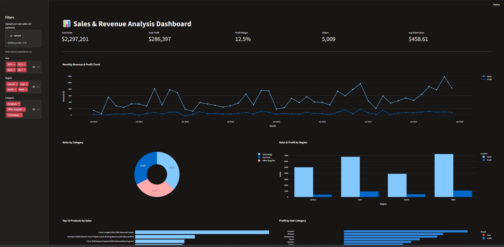

# Sales & Revenue Analysis Dashboard

Interactive dashboard to analyze sales and revenue data. Built as part of the **Thiranex EduTech LLP Data Analytics Internship** (Task 1).

## Problem Statement
Build a dashboard to analyze sales and revenue data: import data, visualize KPIs such as total sales, revenue trends and top-performing products, and use charts, filters and slicers for interactive analysis.

## Features
- **Data import** from CSV (bundled file, or upload your own in the sidebar)
- **KPI cards:** Total Sales, Total Profit, Profit Margin, Orders, Average Order Value
- **Charts:** monthly sales and profit trend, sales by category, sales and profit by region, top 10 products, profit by sub-category, discount vs profit
- **Slicers / filters:** Year, Region, Category
- **Data table** with CSV download of the filtered data

## Tech Stack
Python, Pandas, Plotly, Streamlit

## Project Structure
```
sales-revenue-dashboard/
├── app.py                   # Streamlit dashboard
├── generate_sample_data.py  # creates the sample dataset
├── requirements.txt
├── data/
│   └── sample_sales_data.csv
└── screenshots/             # dashboard screenshots
```

## How to Run
```bash
pip install -r requirements.txt
streamlit run app.py
```
To use the Kaggle **Superstore** dataset, save it as `data/superstore.csv` (it needs the columns Order ID, Order Date, Region, Category, Sub-Category, Product Name, Sales, Profit, Discount). The app picks it up automatically.

## Key Insights
- **Revenue is growing.** Monthly sales rose from 2014 to 2017, with the highest month near the end of 2017, and sales spike toward the end of each year (holiday season).
- **Categories are balanced.** Technology leads sales at about 36%, followed by Furniture (32%) and Office Supplies (31%). The Canon imageCLASS 2200 Advanced Copier is the top product by a wide margin (about $60K in sales), and most of the top 10 are Technology items.
- **West and East lead on regions.** West has the highest sales and profit, followed by East. Central has the lowest profit and South has the lowest sales, so these two regions are the best places to look for improvement.
- **Some sub-categories lose money.** Tables are the biggest loss-maker (about -$18K), followed by Bookcases and Supplies. Copiers, Phones and Accessories bring in the most profit.
- **Heavy discounts destroy profit.** Orders with 0-20% discounts are profitable, but profit turns negative from about 30% and is worst at 50%. Capping discounts at 20% would protect margins.

## Screenshots


## Author
Manoj Kumar N
